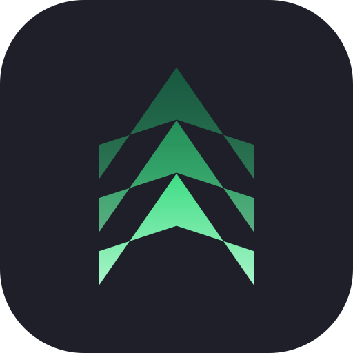
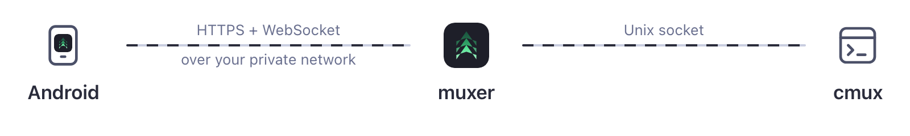

<p align="center">
  
</p>

# Muxer

Watch and drive your [cmux](https://github.com/manaflow-ai/cmux) terminals from an Android phone. See every workspace, open a live terminal, type into it, and get notified when a coding agent needs you.

You don't need to sign in to cmux. Everything runs between your phone and your own computer, over a private network you control, with no cloud service in the middle. [Tailscale](https://tailscale.com) is the easiest way to set that up. Another VPN, a trusted local network, or a Cloudflare Tunnel behind Cloudflare Access also work.

<p align="center">
  <picture>
    <source media="(prefers-color-scheme: light)" srcset="assets/screenshot-computers-light.png">
    
  </picture>
  &nbsp;
  <picture>
    <source media="(prefers-color-scheme: light)" srcset="assets/screenshot-workspaces-light.png">
    
  </picture>
  &nbsp;
  <picture>
    <source media="(prefers-color-scheme: light)" srcset="assets/screenshot-chat-light.png">
    
  </picture>
  &nbsp;
  <picture>
    <source media="(prefers-color-scheme: light)" srcset="assets/screenshot-terminal-light.png">
    
  </picture>
</p>

> [!IMPORTANT]
> This is an independent project. It is not made, endorsed, or supported by Manaflow or the cmux team.

## How it works

<div align="center">
  <picture>
    <source media="(prefers-color-scheme: dark)" srcset="assets/how-it-works-dark.png">
    
  </picture>
</div>

`muxer` is a small program that runs on your computer. It talks to cmux through cmux's local control socket and gives the phone:

- the list of windows, workspaces and terminals, with agent status and unread counts,
- a live view of one terminal, sent as changed rows only, and the keys you type,
- cmux notifications (for example "Claude is waiting for your input"), with their text,
- new Claude Code, Codex or Pi tasks: pick a folder or a workspace that is already open, write the first prompt, and the session opens as a chat.

The phone reaches the relay through an HTTPS proxy in front of it that only your devices can reach, such as `tailscale serve`. See [Reaching the relay](#reaching-the-relay) for the options.

## Set up your computer

You need cmux 0.65 or later on the computer, and a way for the phone to reach the computer over HTTPS. The steps below use Tailscale, signed in on the computer and on the phone. For other setups, see [Reaching the relay](#reaching-the-relay).

1. **Install the relay** with [Homebrew](https://brew.sh):

   ```sh
   brew install gantoine/tap/muxer
   ```

   <details>
   <summary>Other ways to install it</summary>

   Download `muxer-<version>-darwin-arm64.tar.gz` (Apple silicon) or `-darwin-amd64.tar.gz` (Intel) from the [releases page](../../releases), check it against `SHA256SUMS`, extract it, and move `muxer` into a folder on your `PATH`. The binary is not notarized by Apple. If you downloaded it with a browser, run `xattr -d com.apple.quarantine muxer` before the first run.

   </details>

2. **Let the relay talk to cmux.** By default cmux only accepts programs started inside cmux terminals. The relay runs in the background, so switch the socket mode to **password** (recommended) or **automation**:
   - In cmux, open **Settings › Automation** and set socket access to **Password**, then set a password. The relay reads it from `~/.local/state/cmux/socket-control-password`, the same file the cmux CLI uses.
   - Or set `"automation": { "socketControlMode": "automation" }` in `~/.config/cmux/cmux.json`. This lets any program running as your user control cmux without a password.

3. **Start the relay at login.**

   ```sh
   muxer install
   ```

4. **Make it reachable from your phone only.** With Tailscale:

   ```sh
   tailscale serve --bg --https=8765 http://127.0.0.1:8765
   ```

5. **Check everything.**

   ```sh
   muxer doctor
   ```

## Pair your phone

Install the APK from the [releases page](../../releases). To check it first, run `apksigner verify --print-certs muxer-<version>.apk` and compare the SHA-256 certificate fingerprint with this one:

```
9D:6C:85:65:17:81:34:51:CF:1D:82:8F:BC:A0:AE:91:B0:D4:C5:92:B0:74:04:0F:72:19:19:DB:C5:61:5C:8B
```

Then run this on your computer:

```sh
muxer pair
```

`muxer pair` uses the computer's Tailscale name. If the phone reaches the relay another way, pass that address: `muxer pair --url https://muxer.example.com`.

Scan the QR code with your phone's camera, or tap **Pair a computer** in the app and type the address and code. The code works once and expires after 10 minutes.

Each paired computer shows up in the app's **Computers** list.

## Reaching the relay

The app only talks to the relay over HTTPS and only accepts certificates from a public certificate authority, so plain HTTP and self-signed certificates do not work. Keep the relay on `127.0.0.1` and put something in front of it that adds HTTPS and lets only your own devices through:

- **Tailscale:** `tailscale serve` does both. It adds a certificate for the computer's tailnet name and keeps the relay inside your tailnet. `muxer pair` and `muxer doctor` set it up for you.
- **Another VPN** (WireGuard, ZeroTier and so on) **or your local network:** run a reverse proxy such as [Caddy](https://caddyserver.com) on the computer. Point a domain you own at the computer's private address and get a Let's Encrypt certificate with a DNS challenge. Only do this on a network where you trust every device.
- **Cloudflare Tunnel:** put the relay behind Cloudflare Access so only your devices get through. The app cannot complete a browser sign-in, so Access has to recognize the phone another way, for example through the Cloudflare One (WARP) client enrolled in your Zero Trust organization.

Then pair with that address using `muxer pair --url`.

## Opening a terminal's ports

When your phone reaches the computer through Tailscale, a terminal's menu has **Open ports in Tailscale**. It lists the ports that terminal's programs listen on. Tap a port to open it in your phone's browser at the computer's Tailscale name, for example `http://my-mac.tailnet.ts.net:3000`. The phone connects to it directly over your tailnet, not through the relay.

A server that only listens on `127.0.0.1` can't be reached that way, so its port has a switch. Turning it on exposes the port with `tailscale serve`, which gives it an `https://` address on the same port. **Every device on your tailnet can then reach it**, not just your phone. Turn the switch off to stop exposing it. The computer's settings in the app list every port Muxer exposed, including ones whose terminal has closed. This only works with Tailscale for now.

## Custom alerts with cmux automations

The phone shows every notification cmux posts, so a [cmux automation](https://github.com/manaflow-ai/cmux/blob/main/docs/automations.md) with a `notify` action also reaches your phone. For example, this rule in `~/.cmuxterm/automations.json` tells you when cmux types "continue" for an agent after an overload:

```json
{
  "version": 1,
  "rules": [
    {
      "id": "phone-auto-resume",
      "when": { "event": "agent.auto_resume.sent" },
      "then": [
        {
          "action": "notify",
          "title": "Agent resumed",
          "body": "{{payload.agent}} was resumed after a temporary error (attempt {{payload.attempt}})."
        }
      ]
    }
  ]
}
```

Run `cmux automation reload` after editing the file, and `cmux automation test phone-auto-resume --event '{"name":"agent.auto_resume.sent","category":"agent","payload":{"agent":"claude","attempt":1}}'` to check a rule without firing it.

On the phone, open a computer's settings and tap **Automations** to see its rules. You can turn each one on or off, see what it reacts to and what it does, read its recent activity, and reload the file after you edit it. Writing new rules still happens in the file on the computer.

## PostHog Cloud runs

If you run coding agents in the cloud with [PostHog Tasks](https://posthog.com/docs), the Devices list can show your recent tasks under **PostHog Cloud**. Tap one to follow its latest run live as a chat: its messages, tool calls, approval requests and status, with buttons for its pull request and for the task in PostHog. The relay keeps following your runs that are in progress, so the list shows which ones are working, waiting for a reply or need your approval. For now you can only read runs from the phone. Replying and approving still happen in PostHog.

Create a personal API key in PostHog under **Settings › Personal API keys** with the `task:read`, `task:write` and `user:read` scopes, then connect the relay to it:

```sh
muxer posthog-cloud connect                 # US cloud; add --host https://eu.posthog.com for EU
muxer posthog-cloud status
muxer posthog-cloud disconnect
```

`connect` asks for the key without echoing it (or reads `POSTHOG_PERSONAL_API_KEY`), checks it, and saves it in the relay's state folder, readable only by you. The relay asks PostHog for your tasks directly. The key never reaches the phone.

## Updating the relay

```sh
brew upgrade muxer
muxer install
```

Running `muxer install` again restarts the background relay on the new version.

## Managing phones

```sh
muxer devices          # list paired phones
muxer revoke DEVICE_ID # disconnect a phone and make it pair again
muxer uninstall        # stop the relay and remove it from login items
```

## Security

- The phone can do what you can do in cmux: read every terminal and type into it. **Pair only phones you control, and revoke lost ones.**
- Each phone gets its own random token. The computer stores only a SHA-256 hash of it, in `~/Library/Application Support/muxer/devices.json` (mode 0600). The phone keeps it encrypted with a key in the Android Keystore.
- Turn on **Lock Muxer** in the app's settings to ask for your fingerprint, face or screen lock when the app opens or comes back after a minute away (you can pick a longer time). Notifications then show only a generic line on the lock screen if the phone is set to hide sensitive notification content there (Settings › Notifications › Notifications on lock screen), answers and replies from notifications need an unlocked phone, widgets show only counts, and the app stays out of the recents screen.
- Pairing codes are single-use, expire after 10 minutes, and stop working after 10 wrong guesses.
- The relay listens on `127.0.0.1` only. Put it behind an HTTPS proxy that only your devices can reach, such as `tailscale serve`. **Never expose it** with `tailscale funnel`, an open port, or a tunnel without access control.
- Opening a port that listens only on `127.0.0.1` runs `tailscale serve` for it, which makes it reachable from every device on your tailnet until you stop exposing it. The relay only does this for ports your cmux terminals listen on, never for its own port, and never uses `tailscale funnel`. It only removes serve entries it created.
- Pairing, listing, and revoking go through a Unix socket that only your user can open, so none of them can be done over the network.
- The relay only forwards the commands listed in the [relay protocol](DEVELOPMENT.md#relay-protocol). It is not a general cmux socket proxy.

## Development

See [DEVELOPMENT.md](DEVELOPMENT.md) for building, testing, releasing, and the relay protocol.

## License

MIT. See [LICENSE](LICENSE).

The logo remixes the chevron from the cmux icon. cmux and its logo belong to Manaflow, Inc. Using them here does not mean Manaflow made, endorses, or supports this project. If you are from Manaflow and want the logo changed, open an issue.
